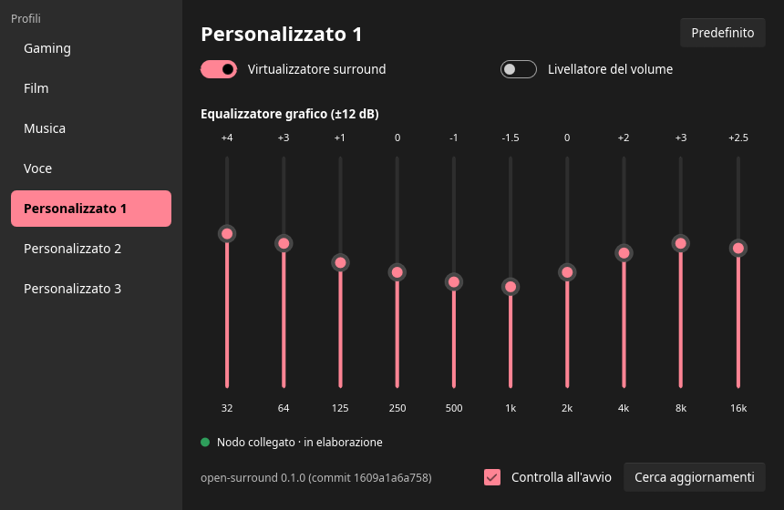

# open-surround

**Dolby Atmos for Headphones on Linux, using Dolby's own audio engine.**

On Windows, Dolby Atmos for Headphones turns game and movie surround sound into binaural audio
for any pair of headphones, and lets you pick between profiles (Game, Movie, Music, Voice and
three custom ones) with an equalizer and a volume leveler. There is no Linux version.

open-surround brings it to Linux. Instead of imitating Dolby's processing, it runs the real
thing: the `DolbyAudioProcessing.dll` module that Dolby Access installs on Windows, loaded
directly on Linux and plugged into PipeWire. You get two new audio outputs on your desktop, a
small settings window with the same controls as the Windows app, and the same sound: in every
test, the output matches what Windows produces to within floating-point rounding.



> **Before you start**
> - The Dolby module is **not included**. You copy it from your own Windows installation of
>   Dolby Access (see [Getting the DLL](#getting-the-dll)). Use it only if you have a Dolby
>   Access license.
> - Linux on x86-64 with PipeWire. A prebuilt package is available; building from source is
>   also possible.
> - The settings window and the command-line messages are in Italian for now. The labels map
>   one to one to Dolby Access (Film = Movie, Musica = Music, Voce = Voice, Personalizzato =
>   Custom, Predefinito = Default).
> - This is a personal project, tested on one machine. It works well there, but expect rough
>   edges.

## What you get

- **Two virtual outputs** in your sound settings:
  - *open-surround stereo (applicazioni)* for everyday applications (browser, music player,
    video calls);
  - *open-surround 7.1 (giochi)* for games and movies with surround sound (5.1, 7.1 or
    7.1.4).

  Both are processed by Dolby's module and played as binaural stereo on your real headphones.
  When one of them is your default output, applications with more than two channels are moved
  to the 7.1 one automatically.
- **All the Dolby Access headphone settings**: the seven profiles, each remembering its own
  settings; the intelligent equalizer (Detailed, Balanced, Warm, Off); Game's performance mode;
  and, in the custom profiles, the surround virtualizer, the volume leveler and the 10-band
  graphic equalizer.
- **A background service**: the audio processing runs as a systemd user service, so closing
  the window keeps the sound, and the last profile is restored at login.
- **Updates from the window**: when a new release is out, the window offers to install it.

## How it works

```
 applications ──► open-surround stereo ─┐
                                        ├─► DolbyAudioProcessing.dll ──► your headphones
 games, films ──► open-surround 7.1 ────┘   (run by os-pipewire)

 settings window (os-ui) ──► control socket ──► os-pipewire
```

- **A loader for Windows DLLs, written in Rust.** `DolbyAudioProcessing.dll` is a Windows
  library. open-surround loads it into a Linux process itself: it maps the file into memory,
  links its imports to small Rust replacements of the Windows functions it uses, and then calls
  it exactly as Windows' audio engine does. No Wine, no virtual machine.
- **A PipeWire node** (`os-pipewire`) creates the two virtual outputs, feeds the module the same
  data Windows would (surround channels for games, stereo for applications, the profile
  settings), and sends the result to your headphones. It follows Windows' behaviour in the
  details too: a fresh module for every listening session, profile changes applied while
  playing, volume applied after the processing.
- **A settings window** (`os-ui`) turns your choices into the same profile data Dolby Access
  writes on Windows, byte for byte, and sends them to the node over a local socket.

## Getting the DLL

open-surround needs `DolbyAudioProcessing.dll`, Dolby's audio processing module. It is Dolby's
proprietary software, so it is not in this repository or in the releases, and never will be:
you take it from a Windows PC where Dolby Access is installed and Dolby Atmos for Headphones is
enabled.

**1. Find it on Windows.** The module comes with Dolby Access's audio components. This command
searches the places where Windows keeps them; run it in PowerShell **as administrator**:

```powershell
Get-ChildItem C:\Windows\System32, 'C:\Program Files\WindowsApps' -Recurse `
    -Filter DolbyAudioProcessing.dll -ErrorAction SilentlyContinue |
    Select-Object FullName, Length, @{n='Version'; e={$_.VersionInfo.FileVersion}}
```

If there is more than one copy, take the most recent version.

**2. Copy it to your Linux machine** (USB stick, network share, `scp`) and check it with
`sha256sum DolbyAudioProcessing.dll`. open-surround was verified with DAP 7.3.7 (`7.3.7.rel`),
whose SHA-256 is:

```
0fada40251880d03c657a357745d362799c93fb6024f733f1c8bf1057f5e4715
```

Other versions may work, but they have not been tested.

**3. Put it where open-surround looks for it:**

| How you run it | Where the DLL goes |
|---|---|
| Prebuilt package, `./open-surround` or `./install.sh` | the extracted package folder, next to the `open-surround` script |
| Built from source, `dist/linux/install.sh` | anywhere: pass its path, `dist/linux/install.sh /path/to/DolbyAudioProcessing.dll` |
| `os-pipewire` or `os-dap-linux` by hand | anywhere: `--dll /path/to/DolbyAudioProcessing.dll` |

Installing copies it to `~/.local/share/open-surround/DolbyAudioProcessing.dll`, where the
service reads it, so you can delete the original afterwards. To replace it later, copy the new
file over that path and run `systemctl --user restart open-surround`.

## Installing

### Requirements

- Linux on x86-64 with PipeWire 1.2 or newer and glibc 2.39 or newer: Debian 13, Ubuntu 25.04,
  Fedora 41, Arch, and anything newer. (Ubuntu 24.04 ships PipeWire 1.0, which is too old.)
- Your copy of `DolbyAudioProcessing.dll` ([above](#getting-the-dll)).

### Prebuilt package

1. Download `open-surround-<version>-linux-x86_64.tar.gz` from the
   [releases page](https://github.com/giacomomicoli/open-surround/releases) and extract it:

   ```
   tar -xzf open-surround-<version>-linux-x86_64.tar.gz
   cd open-surround-<version>-linux-x86_64
   ```

2. Copy your `DolbyAudioProcessing.dll` into that folder.

3. Install it into your home directory and start the service:

   ```
   ./install.sh
   systemctl --user enable --now open-surround
   ```

   Nothing is installed system-wide and no root access is needed: the programs go to
   `~/.local/bin`, the DLL and the install record to `~/.local/share/open-surround`, plus a
   systemd user unit and a menu entry.

4. In your sound settings, choose **open-surround stereo** as the output (or **open-surround
   7.1** if you mostly play games), and open **open-surround** from the application menu to pick
   a profile.

You don't need to connect anything else: open-surround sends the processed sound on to your
headphones by itself, and PipeWire picks the device as it does for other virtual outputs.

**Just trying it out?** Skip step 3 and run `./open-surround` from the package folder. It starts
the processing and the window together; closing the window stops both. Both ways share the same
settings file.

### Using it

- Profile changes from the window take effect immediately, while audio is playing. They are
  saved to `~/.config/open-surround/settings.json`.
- Games and players with 5.1/7.1 output are moved to the 7.1 output by themselves when your
  default output is one of the two. A stream you sent to a specific device yourself is left
  alone.
- `os-ctl stato` shows what the service is doing; `os-ctl versione` shows the installed version.
- `journalctl --user -u open-surround` shows the service log.

### Updating

When the window starts (at most once a day) or when you press **Cerca aggiornamenti**, it asks
GitHub whether there is a newer release. That is a single anonymous request to the GitHub
releases API; nothing about you or your system is sent. You can turn the automatic check off
with **Controlla all'avvio**.

If you installed from the prebuilt package, **Aggiorna** installs the new version in place and
reopens the window. From a terminal, the same is:

```
os-update check
os-update apply
```

Every package is signed. Before replacing anything, `os-update` checks the signature against
the public key built into it ([`dist/linux/minisign.pub`](dist/linux/minisign.pub)) and the
SHA-256, keeps a copy of the installed programs, and puts them back if the new service does not
start. Your settings and the DLL are not touched. If the installed DLL is not the verified
version it asks before going ahead; if it is missing, the window lets you pick it (**Scegli il
DLL…**).

If you built from source, or run the package without installing, the window only links to the
new release: update the repository and run `dist/linux/install.sh` again, or download the new
package.

To check a package by hand: `minisign -Vm open-surround-<version>-linux-x86_64.tar.gz -p
dist/linux/minisign.pub`.

### Uninstalling

```
./install.sh --uninstall
```

(`dist/linux/install.sh --uninstall` if you built from source.) This stops the service and
removes the programs, the service and the menu entry. Your settings
(`~/.config/open-surround`) and the DLL copy (`~/.local/share/open-surround`) are kept; delete
them by hand if you want.

## Building from source

You need Rust (stable), the PipeWire development headers (`libpipewire-0.3`, `libspa-0.2`) and
libclang. Then:

```
git clone https://github.com/giacomomicoli/open-surround
cd open-surround
dist/linux/install.sh /path/to/DolbyAudioProcessing.dll
systemctl --user enable --now open-surround
```

`install.sh` builds in release mode and installs the same files as the prebuilt package. Run it
again after a `git pull` to update (without an argument it keeps the installed DLL).
`dist/linux/package.sh` builds the prebuilt package locally; it then needs the glibc of the
machine it was built on, while the published packages are built on Debian 13.

### Command-line tools

The service is just `os-pipewire` with a few options, and the same engine is available as an
offline renderer. Both take `--help`.

```
# real time: the two virtual outputs, with a profile, without the service
target/release/os-pipewire --profile film:balanced --dll /path/to/DolbyAudioProcessing.dll

# offline: a 48 kHz WAV (stereo, 5.1, 7.1 or 7.1.4) to binaural stereo
target/release/os-dap-linux --profile gaming:performance \
    --dll /path/to/DolbyAudioProcessing.dll in.wav out.wav
```

Profiles are written as `gaming|film|music:<off|balanced|warm|detailed>`, `voice`, or
`custom1|2|3[:virt=on|off][:leveler=on|off][:geq=<10 values in 1/16 dB, 32 Hz…16 kHz>]`.

| Program | What it does |
|---|---|
| `os-pipewire` | the PipeWire node; `--socket` for the control socket, `--target <node>` for the output device, `--no-route` to turn off automatic routing, `--channels 12` for a 7.1.4 games output |
| `os-ui` | the settings window |
| `os-ctl` | sends one command to the running node (`stato`, `versione`, `profilo <profile>`) |
| `os-update` | checks for and installs updates |
| `os-dap-linux` | offline renderer on Linux |
| `os-dap-host` | the same offline renderer on Windows, with Windows' own loader (used to compare the two) |
| `os-blob` | reads, compares and decodes Dolby Access profile data |

The node adds no latency of its own when the PipeWire quantum is a multiple of 256 frames; the
Dolby module itself delays the signal by 512 frames (10.7 ms), and both are reported to
PipeWire.

## How accurate is it?

Every profile state reachable from Dolby Access (19 of them, plus 17 targeted captures of the
graphic equalizer and switches) was recorded on Windows and reproduced by open-surround with the
same input:

| Signal | Difference from Windows |
|---|---|
| Surround test signals (7.1 pink noise per channel, dynamic levels, stereo as game audio) | −148.7 … −149.0 dB (float32 rounding) |
| Stereo from an ordinary application | −134 … −147 dB |
| Real Dolby Atmos content (5.1, 194 s) on Movie, Game, Custom 1 | −148.8 dB |

The same numbers hold for the offline renderer on Windows and Linux and for the live PipeWire
node, at different PipeWire quantum sizes, across separate listening sessions and with profile
changes during playback. The profile data generated by the settings window is byte-identical to
what Dolby Access writes.

## For developers

### Repository layout

```
crates/
├─ os-pe-loader/   native PE32+ loader for Linux and Rust shims of the Windows APIs the module imports
├─ os-dap-core/    platform-independent core: module setup, buffers, metadata, real-time streaming
├─ os-dap-linux/   Linux backend (on the loader) and the offline renderer
├─ os-dap-host/    Windows backend (system loader) and the offline renderer
├─ os-pipewire/    the PipeWire node, plus os-pw-latency (measures latency inside the graph)
├─ os-profiles/    profile model → Dolby Access profile data; settings, control socket, os-ctl, os-blob
├─ os-ui/          settings window (Slint)
├─ os-update/      update check and signed in-place update from a GitHub release
└─ os-verify/      reference tools: ref-capture (Windows recording) and wavcmp (comparison)
dist/linux/        install.sh, package.sh, launcher, systemd unit, menu entry, release public key
docs/reference/    capture and verification scripts, captured profile data
private/           the author's private notes and reference recordings (submodule, not public)
```

A platform backend only has to implement `os_dap_core::Backend` (`open`, `encode`, and
optionally `reconfigure` and `change_properties` for real time).

### Verification

Accuracy is checked against recordings made on Windows. The scripts are in `docs/reference/`:

- `verify-profile.ps1`, `regress-host.ps1`, `fase4-windows.ps1`, `w1-capture.ps1`: record
  reference output and profile data on Windows and compare the Windows build against it;
- `regress-linux.sh`: replays every saved case on Linux through the PE loader (threshold −130
  dB per case; byte-identical to `regress-linux-baseline.sha256`);
- `verify-pipewire.sh`, `verify-sessioni-cambi.sh`, `verify-route.sh`: the same cases, sessions,
  live profile changes and automatic routing on the live PipeWire node, on a private null sink.

The reference recordings are not published: they are the output of Dolby's module, and the
real-audio ones also contain copyrighted material. The scripts expect them in `target/verify`.

### Status and roadmap

| Phase | Goal | Status |
|---|---|---|
| 0-2 | Reconstruct the module's interface; Windows host with identical output; shared core | done |
| 3 | Native PE loader for Linux | done |
| 4 | Real time on Linux: PipeWire node | done |
| 5 | Profile model, byte-identical to Dolby Access | done |
| 6 | Settings window, service, installer, prebuilt package, updates | done on Linux |
| — | Windows build of the settings window; longer listening tests | open |

## Security

Report vulnerabilities privately, not in public issues: see [SECURITY.md](SECURITY.md).
Releases are signed (minisign, key in `dist/linux/minisign.pub`) and the in-app updater
installs only signed packages; release tags cannot be moved once pushed.

## Legal

open-surround is an independent project, not affiliated with or endorsed by Dolby Laboratories
or Microsoft. Dolby, Dolby Atmos and Dolby Access are trademarks of Dolby Laboratories.

It is meant for personal interoperability use by people who hold a valid Dolby Access license.
It contains no Dolby binaries; you must supply the module from your own installation and comply
with its license terms. The profile data under `docs/reference/captures` was captured from the
author's own installation for testing.

## License

The code in this repository is licensed under either of

- Apache License, Version 2.0 ([LICENSE-APACHE](LICENSE-APACHE))
- MIT license ([LICENSE-MIT](LICENSE-MIT))

at your option. This does not cover any Dolby software or data the code interoperates with.
