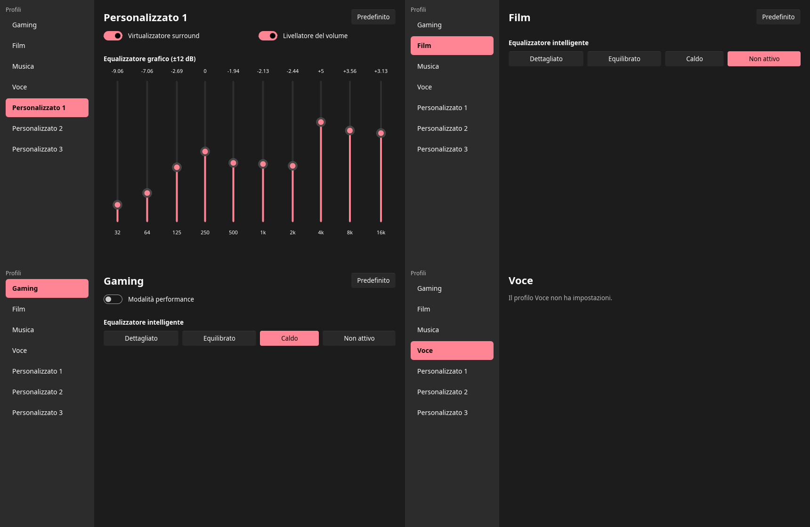

# open-surround

**Dolby Atmos for Headphones on Linux, with exactly the same sound as Windows.**

open-surround runs the original Dolby audio processing module that ships with Dolby Access on
Windows (`DolbyAudioProcessing.dll`, DAP 7.3.7) outside of the Windows audio stack, feeds it the
same profile data that Dolby Access writes, and produces the same binaural output, bit for bit.
The goal is to use a Dolby Access license you already own on Linux, with every profile and
setting of the Windows app (Game, Movie, Music, Voice, Custom 1-3, intelligent equalizer,
graphic equalizer, volume leveler, virtualizer) and no audible difference.

> **Status: work in progress.** Phases 0-4 of the [roadmap](#roadmap) are done: the original
> module runs on Linux through a native PE loader (no Wine), and a PipeWire node (`os-pipewire`)
> runs it in real time with a virtual 7.1 sink for games and a stereo sink for regular
> applications, reproducing the Windows output to within float32 rounding, on the synthetic test
> signals and on 194 s of real 5.1 audio alike, with graph quanta of 1024 and 480 frames. Like
> Windows, the node starts a fresh module for every listening session, applies a profile change to
> the running module through `HandleNotification`, and routes streams that follow the default
> sink to the games or the applications sink by their channel count. Phase 5 is done (section
> 12.14 of the analysis): a profile model with the controls of the app (`os-profiles`) generates
> the Dolby context byte for byte identical to what Dolby Access writes, for all 19 captured
> states and 17 targeted captures (graphic equalizer, switches, "Default" buttons), and imports
> captured blobs back into a profile. The node and the offline renderer take a profile
> (`--profile film:warm`) instead of a capture, with output byte for byte identical in all 77
> regression cases. Phase 6, the user interface, is done on Linux (section 12.15): a settings
> window with the controls of Dolby Access drives the node, which runs as a user service and
> remembers the profile; the Windows build of the window is left.

## Verified results

Every state reachable from the Dolby Access UI (19 configurations: Game ×5, Movie ×4,
Music ×4, Voice, Custom 1 with virtualizer on/off and leveler off, Custom 2, Custom 3) was
recorded on Windows through `ISpatialAudioClient` plus endpoint loopback, then reproduced
offline by open-surround with the same profile blobs — on Windows with the system loader
(phase 1) and on Linux with the native PE loader (phase 3):

| Signal | Residual vs Windows |
|---|---|
| Pink noise on each 7.1 channel, dynamic 7.1 (−40…0 dBFS steps), stereo as game bed | −148.7 … −149.0 dB (float32 rounding) |
| Stereo from a regular application (bypass objects) | −134 … −147 dB |
| Real Atmos content (5.1 core, 194 s) on Movie, Game, Custom 1 | −148.8 dB |

On Linux, all 74 saved captures replay with the same numbers as the Windows host, case by
case (`docs/reference/regress-linux.sh`): beds and dynamics at −148.7…−149.0 dB, application
stereo at −134.0…−147.4 dB, estimated gain 0.000 dB everywhere. The same 74 cases played through
PipeWire into the real-time node and recorded from its output give the same residuals, case by
case (`docs/reference/verify-pipewire.sh`), and so do the 3 real-audio tracks; the node adds no
latency beyond the module's own 512 frames (10.7 ms). The node's recorded output is
bit-identical to the offline render, with the default graph quantum of 1024 frames and with the
graph forced to 480 frames.

Two behaviours of the real module were measured on Windows with an ETW trace and reference
recordings, and reproduced by the node: two sessions separated by a pause both match the
recording of a fresh module (−148.9 dB), as Windows destroys the module when the last stream is
released; a profile change during playback, delivered to the same instance as the same
`HandleNotification` calls Windows makes, matches the Windows recording over the whole track
(−148.9 dB) when it changes the leveler or the equalizer. When it switches the virtualizer off,
the 22 ms crossfade differs, most likely because Windows delivers the notification on another
thread while the module is processing, and the output matches again right after it.

The estimated gain difference is 0.000 dB in every case. Details, including the Windows gain
chain (−3 dB → Dolby → endpoint volume) and how application stereo differs from game beds, are
in the [analysis document](docs/analisi-dolby-access.md) (Italian), sections 12.8-12.10.

## Repository layout

```
crates/
├─ os-dap-core/   platform-independent core (no Windows dependencies)
│   ├─ layout.rs    beds, bypass and dynamic objects, encoder config, channel maps, input gain
│   ├─ abi.rs       in-memory structures read by EncodeAudioData (ObjectEntry, GranuleMeta, …)
│   ├─ props.rs     profile blobs from captures, endpoint properties
│   ├─ engine.rs    ModuleSetup, the Backend trait, Engine (buffers, metadata, block processing)
│   ├─ options.rs   module options shared by the offline renderer and the PipeWire node
│   ├─ realtime.rs  Streamer: graph cycles of any length → fixed module blocks, sessions, volume
│   └─ offline.rs   command line and WAV → WAV rendering, identical on every platform
├─ os-dap-host/    Windows backend: system loader, IAT hooks, in-memory COM objects
├─ os-pe-loader/   native PE32+ loader for Linux: sections, relocations, imports, TLS, DllMain,
│                  synthetic TEB/PEB + GS base, Rust shims of the imported Windows APIs
├─ os-dap-linux/   Linux backend: same COM sequence as the Windows shell, on top of the loader
├─ os-pipewire/    Linux real time: PipeWire node (two virtual sinks → module → binaural output)
│                  and os-pw-latency (latency measured inside the graph)
├─ os-profiles/    Dolby Access profiles (phase 5): profile model → the endpoint's Dolby context
│                  values, identical byte for byte, import back, and os-blob (dump, diff, check,
│                  import); settings of the UI (phase 6), control socket client and os-ctl
├─ os-ui/          settings window (Slint), with the controls of Dolby Access
└─ os-verify/      reference tools: ref-capture (Windows recording) and wavcmp (comparison)
dist/linux/        systemd user unit, menu entry, install.sh, prebuilt package (package.sh, launcher)
.github/workflows/ release.yml: the prebuilt Linux package on every v* tag
docs/
├─ analisi-dolby-access.md   full analysis: interface reconstruction, blob format, verification (Italian)
└─ reference/                capture and verification scripts, captured profile blobs
```

A platform backend only has to implement `os_dap_core::Backend`:

```rust
pub trait Backend: Sized {
    /// Load the module and run DllGetActivationFactory → Initialize →
    /// SetAPOInitParameters → ConfigureEncoder with the data in `setup`.
    fn open(setup: &ModuleSetup) -> Result<Self>;
    /// IDAPModule2::EncodeAudioData.
    unsafe fn encode(&mut self, input: *mut EncodeInput, out: *mut f32) -> Result<()>;
    // Optional, for real time: reconfigure() (ConfigureEncoder again, a fresh module) and
    // change_properties() (new profile blobs plus HandleNotification, same instance).
}
```

## Requirements

- Rust (stable, 2021 edition).
- `DolbyAudioProcessing.dll` from **your own** Dolby Access installation. It is not included and
  never will be: see [Getting the DLL](#getting-the-dll).
- Profiles: either a state of the built-in profile model (`--profile film:warm`), which
  generates the same values Dolby Access writes, or profile blobs captured on Windows with
  `docs/reference/capture_asar.ps1` or `ref-capture` (`--capture`).
- For real time on Linux: PipeWire (developed with 1.6) with the `libpipewire-0.3` and
  `libspa-0.2` headers, and libclang for the bindings; `pw-play`, `pw-record`, `wpctl` for the
  verification script.
- For verification: ffmpeg (test signals) and a Windows machine with Dolby Access and an
  endpoint with Dolby Atmos for Headphones enabled.

## Getting the DLL

open-surround needs `DolbyAudioProcessing.dll`, Dolby's audio processing module, taken from a
Windows PC where Dolby Access is installed and Dolby Atmos for Headphones is enabled. It is
not in this repository or in the releases.

**1. Find it on Windows.** Windows installs it with the Dolby audio components, outside the
Dolby Access app folder. In PowerShell **as administrator**:

```powershell
Get-ChildItem C:\Windows\System32, 'C:\Program Files\WindowsApps' -Recurse `
    -Filter DolbyAudioProcessing.dll -ErrorAction SilentlyContinue |
    Select-Object FullName, Length, @{n='Version'; e={$_.VersionInfo.FileVersion}}
```

If there is more than one copy, take the most recent version.

**2. Copy it to the Linux machine** (USB stick, network share, `scp`). Check it with
`sha256sum DolbyAudioProcessing.dll`. Everything in this repository was verified with DAP
7.3.7 (`7.3.7.rel`):

```
0fada40251880d03c657a357745d362799c93fb6024f733f1c8bf1057f5e4715
```

Other versions may work, but they were not verified.

**3. Put it where open-surround looks for it:**

| How you run it | Where the DLL goes |
|---|---|
| Prebuilt package, `./open-surround` | the extracted package folder, next to the `open-surround` script (or pass `--dll <file>`) |
| Prebuilt package, `./install.sh` | the extracted package folder, or pass its path: `./install.sh /path/to/DolbyAudioProcessing.dll` |
| From the repository, `dist/linux/install.sh` | anywhere: pass its path, `dist/linux/install.sh /path/to/DolbyAudioProcessing.dll` |
| `os-pipewire` or `os-dap-linux` by hand | anywhere: `--dll /path/to/DolbyAudioProcessing.dll` |

Both installers copy it to `~/.local/share/open-surround/DolbyAudioProcessing.dll`, where the
service reads it. After installing, the original can be moved or deleted. To replace it later,
copy the new file over that path, then run `systemctl --user restart open-surround`.

## Building and usage

Same command line on both platforms; only the backend changes.

Windows:

```
cargo build
target\debug\os-dap-host --capture docs\reference\captures\current-2026-11-02 ^
    --capture docs\reference\captures\movie-balanced --endpoint 32ed16b6 in71.wav out.wav
```

Linux (x86-64):

```
cargo build
target/debug/os-dap-linux --profile gaming:performance \
    --dll /path/to/DolbyAudioProcessing.dll --volume-db -9.3428 \
    target/verify/signals/canali71.wav out.wav
```

`--profile` and `--capture` are interchangeable: for every captured state the generated blobs
are identical, so is the output. `os-blob import <capture folder>` prints the state of a capture.

Input is a 48 kHz WAV with 1, 2, 6 (5.1), 8 (7.1) or 12 (7.1.4) channels; output is binaural
stereo float32. Main options (`--help` for all of them):

| Option | Meaning |
|---|---|
| `--profile <state>` | profile generated by the model: `gaming\|film\|music:<off\|balanced\|warm\|detailed>` (`gaming:performance` = `off`), `voice`, `custom1\|2\|3[:virt=on\|off][:leveler=on\|off][:geq=<10 values, 1/16 dB, 32 Hz…16 kHz>]` |
| `--capture <dir>` | capture folder with profile blobs instead of `--profile`; repeatable, later folders override earlier ones |
| `--change <frame>:<state or dir>` | live profile change from that frame, as Dolby Access does |
| `--endpoint <hex8>` | endpoint to take from the captures |
| `--mode cuffie\|speaker` | headphones (default) or built-in speakers |
| `--stereo-bypass` | treat stereo input like a regular application (bypass objects, 0 dB) instead of a game bed |
| `--gain-db`, `--volume-db` | gain before the module (default −3 dB like Windows) and endpoint volume after it |
| `--dll <file>` | path to `DolbyAudioProcessing.dll` |
| `-v` | trace the module's calls into the host and print its internal log |

### Installing on Linux (node as a service, settings window)

```
dist/linux/install.sh /path/to/DolbyAudioProcessing.dll
systemctl --user enable --now open-surround
```

`install.sh` builds in release mode and installs into your home directory only:
- `os-pipewire`, `os-ui`, `os-ctl` and `os-blob` into `~/.local/bin`;
- a copy of the DLL into `~/.local/share/open-surround`;
- the user unit `open-surround.service`;
- the `open-surround` menu entry.

It does not start anything itself: `systemctl --user enable --now open-surround` starts the node
now and at every login. Then make `open-surround-stereo` (or `open-surround-7.1`) your default
sink and open **open-surround** from the menu.



The window (`os-ui`) has the controls of Dolby Access: the seven profiles, each remembering
its own settings, the intelligent equalizer presets, the Game performance mode, the Custom
profiles' virtualizer, volume leveler and 10-band graphic equalizer, and "Default". Every change
is saved to `~/.config/open-surround/settings.json` and sent to the running node at once. The
node starts from the saved profile (`--settings`) and takes changes on its control socket
(`--socket`, `$XDG_RUNTIME_DIR/open-surround/control.sock`), so closing the window keeps the
sound, and restarting the node keeps the profile. `os-ctl stato` prints what the node is doing.
`dist/linux/install.sh --uninstall` removes everything except your settings and the DLL copy.

### Prebuilt package (Linux x86_64, no build needed)

Each `v*` tag gets `open-surround-<version>-linux-x86_64.tar.gz` on its GitHub release,
built by `.github/workflows/release.yml` with `dist/linux/package.sh`. It does not contain
Dolby's module: download it from the
[releases page](https://github.com/giacomomicoli/open-surround/releases) and extract it
(`tar -xzf open-surround-<version>-linux-x86_64.tar.gz`). Then copy your
`DolbyAudioProcessing.dll` ([Getting the DLL](#getting-the-dll)) into the extracted folder:

```
open-surround-<version>-linux-x86_64/
├─ DolbyAudioProcessing.dll   ← your copy goes here
├─ open-surround
├─ install.sh
├─ bin/  share/  LEGGIMI.txt  …
```

and either

```
./open-surround        # run without installing: node + window, closing the window stops the node
./install.sh           # or install it as above, from the package's binaries
```

`./open-surround --senza-finestra` runs only the node, `--dll <file>` takes the DLL from
elsewhere. If a node is already running (the installed service) it opens only the window. Both
ways share `~/.config/open-surround/settings.json`. The package is built in Debian 13 and needs
glibc 2.39 and PipeWire 1.2 or newer. `dist/linux/package.sh` builds the same package locally (it
then needs the glibc of the machine it was built on).

### Real time on Linux (PipeWire)

`os-pipewire` takes the same module options and creates two virtual sinks in front of the
module plus a binaural stereo output, all in one PipeWire node group:

```
cargo build --release
target/release/os-pipewire --profile film:balanced \
    --dll /path/to/DolbyAudioProcessing.dll
```

| Node | Role |
|---|---|
| `open-surround-7.1` (`--channels 12`: `open-surround-7.1.4`) | games: the channels go to the module's beds with −3 dB, like a spatial audio client on Windows |
| `open-surround-stereo` | regular applications: the two bypass objects at 0 dB, like a plain WASAPI stream on Windows |
| `open-surround-output` | binaural output, linked to the default device or to `--target <node>` |

Both sinks feed the same `EncodeAudioData` call in the same graph cycle, as on Windows. Their
volume (one value shared by the two sinks, like a Windows endpoint) is applied after the module,
where Windows applies the endpoint volume; the signal entering the module is never scaled.

The module is only called while a sink receives audio. When the last stream linked to the two
sinks goes away, the module is reconfigured, so the next session starts from a clean module
state, as on Windows, which creates a new module for every stream (the volume leveler remembers
what it processed). `--idle-ms <n>` also resets it after n ms of silence with streams still linked.

Profile changes during playback: the settings window uses the control socket (`--socket <path>`;
one command per connection, one `ok …`/`errore …` reply line; `os-ctl` sends one from a shell).
With `--control <fifo>` the node reads commands from a FIFO
(created if missing), one per line. `profilo <state>` (or `profilo <capture folder>`) hands the
module the blobs of that profile on the same instance, with the notifications Windows sends when Dolby Access writes
a profile, so the leveler state survives the change as on Windows:

```
target/release/os-pipewire --profile film:balanced --dll … --control /run/user/$UID/os-control &
echo "profilo music:warm" > /run/user/$UID/os-control
```

Routing: when the default sink is one of the two, a stream that did not pick a sink itself goes to
`open-surround-7.1` if it has more than 2 channels and to `open-surround-stereo` otherwise. The
node sets the stream's `target.object` in the `default` metadata, as pavucontrol does when the user
moves a stream, and WirePlumber relinks it; the format is known once the stream is linked, so
its first cycles may play in the other sink. A stream with its own target (`pw-play --target`,
`PULSE_SINK`, `node.target`, `node.dont-move`) or moved by the user is left alone. `--no-route`
turns the rule off. So the usual setup is: make `open-surround-stereo` (or `open-surround-7.1`)
the default sink, and games with 5.1/7.1 output land in the games sink by themselves.
PipeWire upmixes stereo streams played into the 7.1 sink unless the client sets
`channelmix.upmix = false`.
The node adds no latency when the graph quantum is a multiple of 256 frames (256, 512,
1024…) and less than 256 frames otherwise; the module itself delays the signal by 512 frames
(10.7 ms). Both are announced to the graph (`ProcessLatency`), so players can compensate.
`os-pw-latency` measures what the node adds inside the graph. Other options: `--help`.

## Verification workflow

- `docs/reference/verify-profile.ps1 -Name <profile>`: with the profile selected in Dolby Access,
  plays the test signals on Windows, records the processed loopback and the profile blobs, renders
  the same signals with open-surround and compares them.
- `docs/reference/regress-host.ps1 [-Baseline <exe>]`: replays every saved capture in
  `target/verify` without Dolby Access, compares against the Windows loopback and optionally
  against another build byte for byte. This is the acceptance test for every later phase.
- `docs/reference/fase4-windows.ps1 -Step controllo|sessioni|cambio` (administrator PowerShell):
  records sessions separated by pauses and live profile changes with `ref-capture` while an ETW
  session collects the log of the real Dolby module inside `audiodg`
  (`docs/reference/etw-dolby-csv.ps1` turns the trace into CSV); outputs in `target/verify-fase4`.
- `docs/reference/regress-linux.sh [dll] [filter]`: same replay on Linux with the native PE
  loader (`os-dap-linux`), same acceptance threshold of −130 dB residual per case.
- `QUANTUM=<n> docs/reference/regress-linux.sh`: the same replay through the real-time adapter
  in cycles of n frames (`--quantum`); the outputs must stay byte-identical to the baseline
  (`docs/reference/regress-linux-baseline.sha256`).
- `docs/reference/verify-pipewire.sh [dll] [filter]`: the phase 4 acceptance test. For every
  saved capture it starts `os-pipewire` on a private null sink, plays the test signal into the
  right sink with `pw-play`, records the node's output with `pw-record` and compares it with the
  Windows loopback (same −130 dB threshold). `LATENCY=<n>` asks the graph for another quantum
  (on a machine with a higher `clock.min-quantum`, force it with `pw-metadata -n settings 0
  clock.force-quantum <n>` and set it back to 0 afterwards). The recording goes to memory
  (`$XDG_RUNTIME_DIR`) first: written straight to disk at 480 frames, `pw-record` dropped whole
  cycles on long tracks. Run the 194 s tracks on an idle machine: under load `pw-play` can miss a
  cycle (it shows up as empty cycles of the games sink in the node's `-v` statistics), and with the
  volume leveler one lost cycle changes the rest of the track. `NODE_ARGS="…"` passes extra
  options to the node.
- `docs/reference/verify-sessioni-cambi.sh [sessioni|cambi|tutto]`: on the live node, two
  sessions separated by a pause (each must match the fresh-module reference) and the three profile
  changes recorded on Windows (`target/verify-fase4`, from `fase4-windows.ps1`), sent through the
  control FIFO at the frame found offline with `os-dap-linux --change <frame>:<folder>`; the node's
  output must also be bit-identical to the offline render with the same changes.
- `docs/reference/verify-route.sh`: automatic routing with `pw-play` and `paplay` streams, with
  and without their own target. It switches the default sink to the node for a few seconds and
  restores it at the end.
- `docs/reference/trace-shims.gdb`: gdb script that prints which risky Windows API shims the
  module actually calls during a run, with arguments, return values and the calling RVA (used to
  triage phase 3-bis); `docs/reference/trace-node.sh` runs it on the live PipeWire node with a
  fixed scenario (both sinks at once, volume and mute changes, two live profile changes, end of
  session, second session).
- `os-pw-latency`: measures, inside the PipeWire graph, the latency the node adds (impulses into a
  sink, detected on the monitor of the sink the node plays to).

The recordings in `target/verify` are large and are not part of the repository. The synthetic-signal
cases (75 captures with their test signals) are published as a release asset:

```
gh release download verify-data-2026-11-03 -p verify-data.tar.gz
tar -xzf verify-data.tar.gz -C target
```

Some `info.txt` files reference their input with an absolute Windows path; the input files are in
`target/verify/signals/`.

The 3 real-audio cases (an excerpt of a Dolby Atmos test track, 5.1, 194 s; Movie Balanced, Game
performance, Custom 1 without virtualizer) contain non-redistributable material and are not
published anywhere. They live on the Windows capture machine and travel to Linux by hand as
`verify-reale.tar.gz` (exported with step W3 of section 12.13; the SHA-256 is written there). It
is extracted with `tar -xzf verify-reale.tar.gz -C target/verify` into three folders
`target/verify/reale-real-*`, each with its own copy of the input, and checked with the filter
`reale-` of `regress-linux.sh` and `verify-pipewire.sh` (steps L1-L3).

## Roadmap

| Phase | Goal | Status |
|---|---|---|
| 0 | Reconstruct the `IDAPModule2` interface and the call sequence of the Windows shell | done |
| 1 | Windows host that loads the module and renders WAV → binaural stereo, identical to Windows | done |
| 2 | Shared core `os-dap-core` behind a backend trait | done |
| 3 | Native PE loader for Linux (sections, relocations, imports, TLS, static CRT, `DllMain`) plus Rust shims for the imported Windows APIs | done |
| 3-bis | Shim correctness before real time: defects found in review after phase 3 (RTWorkQ, backend IIDs, `WindowsStringHasEmbeddedNull`, condition variables, `VirtualProtect`, named objects, thread exit), off the offline path or working by chance; see section 12.12 of the analysis | done: every fix has its unit test, Linux regression byte-identical to phase 3; on Windows the auxiliary IID is confirmed (`67b16434`, both backends) and the workspace builds; final Linux check done on 2026-11-04 (same `[qi]` line as Windows, 74/74 cases byte-identical to the baseline) |
| 4 | Real time on Linux: PipeWire node with a virtual 7.1(.4) sink for games and stereo routing for regular applications | done (2026-11-06): `os-pipewire`; all 77 cases (74 synthetic, 3 real-audio tracks) recorded from the node's output through PipeWire match the Windows references (−134.0…−149.0 dB, gain 0.000 dB) and are bit-identical to the offline render at graph quanta of 1024 and 480 frames; volume after the module; the node adds only the module's 512 frames of latency. From an ETW trace of the real module on Windows: a fresh module for every session (verified on the node at −148.9 dB), live profile changes through `HandleNotification` on the same instance (2 of the 3 recorded changes at −148.9 dB over the whole track, the virtualizer switch differs only during its 22 ms crossfade), automatic routing of games and applications by channel count |
| 5 | Profile model and blob serializer, byte-identical to what Dolby Access writes | done (2026-11-11, section 12.14 of the analysis): codec of the six Dolby context values; profile model generating all 19 captured states and the 17 targeted Windows captures (graphic equalizer 10 → 20 bands, switches, "Default" buttons) byte for byte, and importing captures back; `--profile` in the offline renderer and the node with output identical to the captures in all 77 regression cases; each profile's default for the UI |
| 6 | User interface with the same controls as Dolby Access, on both platforms | in progress (section 12.15 of the analysis): Slint app over the phase 5 profile model, a control socket for the node, settings saved per profile. Step L1 done (2026-11-11): the UI logic (`os_profiles::Settings`) reaches all 36 captured states through the app's controls with byte-identical blobs, with per-profile memory and "Default" buttons as in Dolby Access. Step L2 done (2026-11-12): a control socket on the node (`--socket`, answered commands, `os-ctl`) and `--settings` to start from the saved active profile; live changes sent over the socket give output bit-identical to the FIFO. Step L3 done (2026-11-12): the Slint window `os-ui` (profiles, IEQ presets, performance mode, switches, 10-band graphic EQ, "Default"), which saves the settings and drives the node. Step L4 done (2026-11-12): systemd user unit, menu entry and `install.sh`; the node restarts from the saved profile. Left: the Windows build (W1) and a hands-on listening test |

Acceptance for phases 3-4: the same inputs and blobs give a residual of about −149 dB against the
Windows recordings in every configuration (−134…−147 dB for application stereo, as on Windows).

## Legal

open-surround is an independent project, not affiliated with or endorsed by Dolby Laboratories
or Microsoft. Dolby, Dolby Atmos and Dolby Access are trademarks of Dolby Laboratories.

It is meant for personal interoperability use by people who hold a valid Dolby Access license.
It contains no Dolby binaries; you must supply the module from your own installation and comply
with its license terms. The profile blobs under `docs/reference/captures` were captured from the
author's own installation for testing.

## License

The code in this repository is licensed under either of

- Apache License, Version 2.0 ([LICENSE-APACHE](LICENSE-APACHE))
- MIT license ([LICENSE-MIT](LICENSE-MIT))

at your option. This does not cover any Dolby software or data the code interoperates with.
